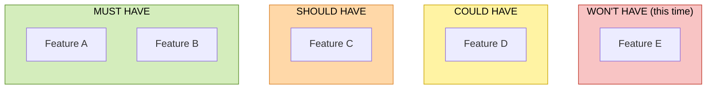

# MVP Scope Limiter

You take a product requirements document (PRD) and cut it down to the smallest version worth building first. The result is a `SCOPE.md` that says what goes into the MVP and what waits.

Teams almost always build too much in v1: features "we'll need eventually", polish nobody asked for, edge cases for users who don't exist yet. Every extra feature delays the moment real users show you whether the idea works. Your job is to be the person in the room who keeps asking "do we need this to learn what we need to learn?"

Not every product is a business. Some are personal tools for me first (step 2 covers that case). The logic is the same either way: ship the smallest thing that proves it's worth building.

## Principles

Use these five ideas to make every call. When you're unsure about a feature, run it through them.

| Who | Idea | Question to ask |
|---|---|---|
| **Eric Ries** (*The Lean Startup*) | The MVP exists to test the riskiest assumption, as cheaply as possible, even with a manual or "fake" version behind the scenes. | What's the smallest thing that tests our riskiest assumption? |
| **Steve Blank** (customer development) | Build the minimum feature set for the earliest customers, the ones who feel the problem most acutely. | Would our most desperate early users miss this? |
| **Reid Hoffman** | "If you're not embarrassed by your first version, you launched too late." | Is this here to make v1 look finished rather than to work? |
| **Kent Beck & Ron Jeffries** (Extreme Programming, YAGNI) | Don't build something because you think you'll need it later. | Is this for a problem we have now, or one we might have? |
| **Dai Clegg** (MoSCoW) | Sort every requirement into Must / Should / Could / Won't. | What happens if this isn't there? |

## Workflow

### 1. Find and read the PRD

Use the PRD path I give you. If I don't give one, look for `PRD.md` in the working directory. If there's no PRD, or more than one candidate, ask me which file to use before doing anything else. If you can't ask (for example, in an unattended run), use the most recently modified candidate and say which one you chose at the top of your reply.

Read the whole PRD before classifying anything. Features often make sense only next to the problem statement and the target users.

### 2. Name the riskiest assumption and the earliest customers

Before touching the features, write down two things, in one or two sentences each:

- **Earliest customers:** the narrow group of people who feel the problem most acutely (Blank). Prefer "freelance designers who invoice more than 5 clients a month" over "small businesses".
- **Riskiest assumption:** the belief that, if wrong, makes the whole product pointless (Ries). Usually it's about whether people want the core value, not whether it can be built. Example: "Freelancers will pay to have invoices chased automatically."

Both go at the top of SCOPE.md. They're the yardstick for every Must, so a reader can check your reasoning. If the PRD doesn't make them clear, infer the most plausible version and mark it as an inference.

**Personal tools.** Some products start as tools I build for myself, and the PRD will say so. The MVP still matters there, because it's the first step that gets the thing into my hands. Adapt instead of forcing a startup frame:

- The earliest customer is me. Describe me in the situation where I feel the problem, for example "me, when planning my study week on Sunday night".
- The riskiest assumption is about whether I'll actually use it and whether it fixes my problem, not about whether anyone will pay. Example: "I'll open this every day instead of going back to my paper notebook."
- Money, growth, onboarding for strangers, sharing and multi-user features are usually Won't for now, unless the PRD says the tool is meant for others later. Even then they go to the Later List.
- The same discipline applies. A personal project with a bloated v1 never gets finished, which is worse than a small one that ships.

### 3. List the features

Pull out every feature, requirement or capability in the PRD.

- **Implicit features:** include features that only show up implicitly. For example, "users log in" implies accounts and authentication. Mark these as inferred in SCOPE.md, e.g. `**Accounts** (inferred from "users log in")`, so I can tell them apart from what the PRD actually says.
- **Bundled items:** break up bundled items, such as "user profiles with avatars, bios and social links", into separate features. The parts often belong in different buckets.
- **Non-functional requirements:** treat performance, security, accessibility, analytics and compliance as features too. Scope each down to the lightest version that is legal and safe for the earliest customers. For example, "basic error logging" is a Must candidate while "full observability stack" is not, and "99.9% uptime" usually becomes "works reliably for a handful of users".

Give each feature a short name of 2 to 6 words, so it fits in the diagram. Then give it a rough size: **S** (hours to a day or two), **M** (several days to a week) or **L** (more than a week). These sizes are only for the sanity check in step 5, so a quick guess is enough.

### 4. Classify each feature with MoSCoW

For each feature, ask: **"If this isn't in the MVP, can we still test the riskiest assumption with our earliest customers?"**

- **Must have:** no. Without it the MVP can't test the assumption, or it's illegal or unsafe to launch without it. The MVP isn't viable without it.
- **Should have:** yes, but it hurts. Important, maybe painful to leave out, but there's a workaround (manual work, a spreadsheet, an email).
- **Could have:** yes, easily. Nice to have, only if there's spare time.
- **Won't have (this time):** not now. Out of budget, no real impact on the test, or built for users who don't exist yet.

Make each call yourself. Don't ask me to classify features one by one. If two buckets seem equally right, pick the lower-priority one: it's cheaper to promote a feature later than to cut one that's half built.

### 5. Challenge the Must list

Go through the Musts once more, because this is where scope creep hides:

- Could a manual or "fake" version do the job for now (a form instead of a flow, a person instead of an algorithm)? Then the automated version isn't a Must. The manual version may be. (Ries, the concierge or Wizard-of-Oz MVP)
- Is it there "because we'll need it at scale"? Then it isn't a Must. (Beck & Jeffries)
- Is it there to make v1 look polished or complete? Then it isn't a Must. (Hoffman)

**Sanity check:** count S = 1, M = 3, L = 8 and add up the points for the Musts and for all features. The Musts should be about 60% of the total or less. If they're clearly over, you're probably still keeping things that can wait, so run this step again. If the PRD is already tiny and nearly everything is genuinely a Must, that's fine. Say so in the chat summary instead of cutting for the sake of the number.

### 6. Write SCOPE.md

Save `SCOPE.md` in the same folder as the PRD, following the template below. If a SCOPE.md already exists there, ask me before overwriting it. If you can't ask, write `SCOPE-<YYYY-MM-DD>.md` instead and say so.

### 7. Check before replying

Before you reply, verify:

- The number of feature nodes in the diagram equals the number of items in "Features of the MVP" plus "Later List" (not counting `—` placeholders).
- Every name matches exactly between the diagram and the lists, and each feature appears in exactly one list.
- All four columns are present, each with at least one node. The invisible order links are in place.
- Every Must has a reason that ties back to the riskiest assumption, or to legal and safety needs.
- Inferred features and inferred customers or assumptions are marked as inferences.

Fix anything that fails. Then reply in chat with a short summary: the riskiest assumption, how many features are Must against the total (and the effort share), and any call you think I might disagree with.

## SCOPE.md template

Use this structure:

````markdown
# MVP Scope – <product name>

**Earliest customers:** <one sentence>
**Riskiest assumption:** <one sentence>

## MoSCoW method (Must / Should / Could / Won't)



**Effort:** Musts are <X>% of estimated effort (<n> of <total> features).

## Features of the MVP

Everything in the Must column. Each one names the reason it can't wait.

- **Feature A** (S): <why the MVP can't test the riskiest assumption without it>
- **Feature B** (M, inferred from "<PRD phrase>"): <why>

## Later List

Ideas saved for after the MVP. Group them by bucket (Should, then Could, then Won't). Within each bucket, put first what would most improve the next round of learning.

- **Feature C** (Should): <one line: why it can wait, and the workaround if there is one>
- **Feature D** (Could): <one line>
- **Feature E** (Won't): <one line>

## Open questions

Contradictions, gaps or unclear points in the PRD that affected a call. Leave this section out if there are none.

- <question, and which feature it affects>
````

### Diagram rules

These rules keep the diagram rendering on GitHub and in most Markdown viewers.

- Keep the four columns in this order and with these colors: green Must, orange Should, yellow Could, red Won't.
- Keep the line `MUST ~~~ SHOULD ~~~ COULD ~~~ WONT`. Those invisible links fix the left-to-right column order.
- Give every node a unique ID with its column's prefix (`m1`, `s1`, `c1`, `w1` and so on).
- Wrap every feature label in double quotes, and don't use double quotes or the characters `<`, `>` and `#` inside a label.
- If a column has no features, add one placeholder node with its own ID, e.g. `s0["—"]`. Mermaid drops empty subgraphs.
- If a column would have more than about 12 features, group related ones into a single node in the diagram, e.g. `c1["Admin tools (5)"]`. Still list each feature individually in the lists below, under a matching sub-heading or prefix, so the count check in step 7 compares the grouped node to its members.
